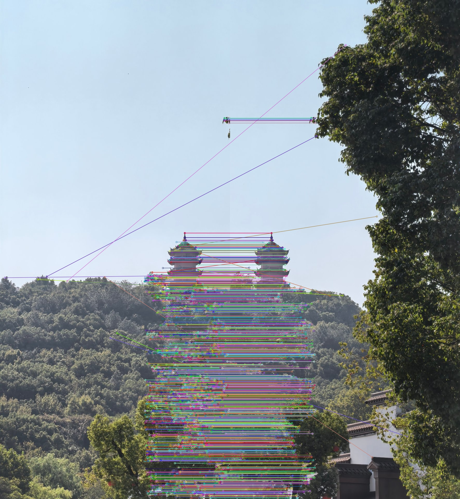
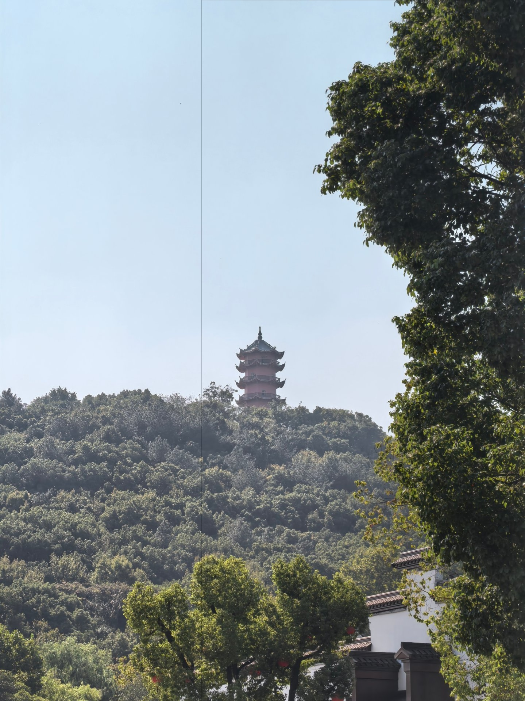

# 实验三　图像拼接与融合实验报告

> 基于 SIFT 特征与单应矩阵的全景图拼接

---

## 目录

- [一、实验目的](#一实验目的)
- [二、实验原理](#二实验原理)
  - [2.1　SIFT 特征提取](#21sift-特征提取)
  - [2.2　FLANN 匹配与 Lowe 比率测试](#22flann-匹配与-lowe-比率测试)
  - [2.3　RANSAC 估计单应矩阵](#23ransac-估计单应矩阵)
  - [2.4　透视变换拼接与加权融合](#24透视变换拼接与加权融合)
- [三、算法流程](#三算法流程)
- [四、实验环境与步骤](#四实验环境与步骤)
- [五、实验结果](#五实验结果)
- [六、结果分析与实验总结](#六结果分析与实验总结)

---

## 一、实验目的

1. 理解局部图像特征提取的基本原理，掌握 SIFT 算法的尺度空间构建、关键点检测与描述子生成过程；
2. 掌握基于 FLANN 的快速特征匹配方法及 Lowe 比率测试的误匹配筛选策略；
3. 理解单应矩阵的几何意义，掌握使用 RANSAC 算法鲁棒估计单应矩阵的方法；
4. 实现两幅存在重叠区域图像的透视变换拼接，并通过加权渐入渐出策略消除拼接接缝，完成全景图融合。

## 二、实验原理

### 2.1　SIFT 特征提取

SIFT 是一种对尺度、旋转、亮度变化具有不变性的局部特征描述算法，主要包括四个步骤：

1. **尺度空间极值检测**：对不同尺度的图像与高斯核 $G(x,y,\sigma)$ 卷积构建高斯金字塔，相邻层相减得到高斯差分（DoG）金字塔，在 DoG 的同一组相邻层及上下邻域像素中检测局部极值点作为候选关键点；
2. **关键点定位**：对候选点做曲线拟合实现亚像素精化，并剔除低对比度点和边缘上的不稳定响应点；
3. **方向指定**：统计关键点邻域内梯度的方向直方图，取峰值方向作为主方向，使描述子具备旋转不变性；
4. **生成描述子**：将关键点邻域划分为 $4 \times 4$ 子区域，每个子区域统计 8 个方向的梯度直方图，形成 $4 \times 4 \times 8 = 128$ 维特征向量，并做归一化以降低光照变化的影响。

### 2.2　FLANN 匹配与 Lowe 比率测试

对两幅图像的 128 维描述子集合进行最近邻搜索即可得到候选匹配。FLANN（Fast Library for Approximate Nearest Neighbors）采用 KD 树索引实现高维空间的近似最近邻查找，在保证匹配质量的同时显著提高搜索速度。本实验使用 `knnMatch(k=2)` 为每个描述子返回 2 个最近邻，再依据 Lowe 比率测试筛选：

$$\frac{d(m, nearest)}{d(m, second\_nearest)} < 0.7$$

若最近邻距离与次近邻距离过于接近，说明该匹配区分度低、易受噪声干扰，应予以剔除。阈值取 0.7～0.8，取值越小筛选越严格。

### 2.3　RANSAC 估计单应矩阵

若两幅图像由相机绕光轴转动拍摄同一平面场景（或纯旋转拍摄），则对应点之间满足透视投影关系：

$$\begin{bmatrix} x' \\ y' \\ 1 \end{bmatrix} = H \begin{bmatrix} x \\ y \\ 1 \end{bmatrix}, \quad H = \begin{bmatrix} h_{11} & h_{12} & h_{13} \\ h_{21} & h_{22} & h_{23} \\ h_{31} & h_{32} & 1 \end{bmatrix}$$

$H$ 为 3×3 单应矩阵，有 8 个自由度，至少需要 4 对匹配点求解。由于初始匹配中仍可能存在误匹配，直接最小二乘会被外点严重干扰。RANSAC（Random Sample Consensus）通过随机抽取 4 对点迭代求解 H、统计投影误差小于阈值的内点数量，保留内点数最多的模型，再用全部内点重新精化 H，从而对误匹配具有强鲁棒性。

### 2.4　透视变换拼接与加权融合

求得 H（右图 b → 左图 a）后，对 b 做透视变换 `warpPerspective` 即可映射到 a 的坐标系。考虑到变换后部分坐标为负值，需先由两图四角点计算拼接画布范围，并用平移矩阵 T 与 H 复合（即 $T \cdot H$）保证所有像素落在画布内。

直接将 a 覆盖到画布上会在重叠区形成一条突变接缝。本实验在重叠区域沿水平方向做线性加权渐入渐出融合：

$$I_{fuse}(x,y) = \alpha(x) \cdot I_a(x,y) + (1-\alpha(x)) \cdot I_b(x,y), \quad \alpha(x) = 1 - \frac{x - x_{left}}{x_{right} - x_{left}}$$

即重叠区左端完全取 a、右端完全取 b，中间平滑过渡，从而消除接缝并平衡两图曝光差异。最后根据非零像素范围裁剪黑边，得到最终全景图。

## 三、算法流程

```
读入 a.jpg / b.jpg
        │
        ▼
灰度化 ──► SIFT 提取关键点与 128 维描述子
        │
        ▼
FLANN(KD 树) KNN 匹配 (k=2)
        │
        ▼
Lowe 比率测试 (0.7) 筛选优质匹配
        │
        ▼
RANSAC 估计单应矩阵 H (b→a)
        │
        ▼
计算画布范围 + 平移矩阵 T ──► warpPerspective 变换 b
        │
        ▼
a 贴入画布；重叠区加权渐入渐出融合
        │
        ▼
裁剪黑边 ──► 输出匹配图与拼接结果
```

## 四、实验环境与步骤

| 项目 | 配置 |
|------|------|
| 操作系统 | Windows / Linux 均可 |
| 编程语言 | Python 3.11 |
| 核心依赖 | OpenCV 4.13（含 SIFT）、NumPy |
| 测试图像 | a.jpg（左图，887×1920）、b.jpg（右图，887×1920），为同一古塔场景从左、右两个视角拍摄的竖幅照片，水平方向存在明显重叠 |

依赖安装：

```bash
pip install opencv-python numpy
```

运行方式：

```bash
python3 image_fusion.py          # 无图形界面环境（默认）
python3 image_fusion.py --show   # 本机桌面环境，弹窗显示结果
```

主要实验步骤与 `image_fusion.py` 中的代码模块一一对应：

1. 读入图像并转为灰度图（第 1 部分）；
2. 调用 `cv2.SIFT_create()` 分别检测两图关键点与描述子（第 2 部分）；
3. 构建 FLANN KD 树匹配器，`knnMatch(k=2)` 匹配并按比率阈值 0.7 筛选（第 3 部分），用 `drawMatches` 可视化匹配关系；
4. 由优质匹配点对调用 `cv2.findHomography(..., cv2.RANSAC, 5.0)` 估计单应矩阵（第 4 部分）；
5. 计算变换后四角点，确定画布尺寸并构造平移矩阵，`warpPerspective` 将 b 映射到画布（第 5～6 部分）；
6. 将 a 贴入画布，对重叠区按 x 方向线性权重做渐入渐出融合，再裁剪黑边（第 6～7 部分）；
7. 保存并显示特征匹配图、直接覆盖拼接图与融合拼接图三组结果（第 8～9 部分）。

## 五、实验结果

### 5.1　特征提取与匹配结果

| 统计项 | 数值 |
|--------|------|
| a 图 SIFT 关键点数 | 8625 |
| b 图 SIFT 关键点数 | 11376 |
| KNN 原始匹配对数 | 8625 |
| 比率测试后优质匹配对数 | 1669 |
| RANSAC 内点数 | 1656（内点率 99.2%） |

估计得到的单应矩阵 H 为：

$$H = \begin{bmatrix} 0.99974 & -0.000115 & 552.42 \\ 0.000058 & 0.99957 & 0.31 \\ -1.2 \times 10^{-8} & -1.43 \times 10^{-7} & 1 \end{bmatrix}$$



由上图可见，绝大多数匹配连线近似水平且相互平行，塔身、山林纹理等区域的匹配点分布密集且方向一致，说明 SIFT 描述子在该场景下区分度高，比率测试有效剔除了歧义匹配；RANSAC 内点率高达 99.2%，进一步证明筛选后的匹配集合质量很高。

### 5.2　拼接与融合结果




两图拼接后画布宽度约 1752 像素（两图各宽 887 像素、重叠约 22 像素，与平移量 $h_{13} \approx 552$ 的水平视差相符）。直接覆盖版（参考代码做法）在重叠边界处可见亮度突变形成的竖直接缝；加权融合版中接缝被完全消除，古塔、山脊线、树木纹理在重叠区内平滑过渡，天空色调过渡自然，全景图整体结构连续、无错位与鬼影。

## 六、结果分析与实验总结

1. **特征匹配质量分析**：本组图像为竖幅、大面积天空，纹理主要集中在塔身与山林区域，SIFT 在这些区域提取的关键点稳定且描述子区分度高；大面积平坦天空区域几乎不产生有效匹配，符合局部特征"依赖灰度变化"的特点。比率测试将匹配数从 8625 对压缩到 1669 对，剔除率约 80%，说明原始 KNN 匹配中存在大量不可靠匹配，Lowe 比率测试是保证匹配质量的关键环节。
2. **RANSAC 的作用**：由于相机水平转动近似、场景深远，几何模型符合单应约束，内点率高达 99.2%。若场景存在明显视差（近景物体位移与远景不一致），单应模型将不再成立，需改用本质矩阵/基础矩阵并配合多频段融合或多波段拼接方法。
3. **接缝处理**：直接覆盖策略使后贴入的图像完全遮盖先变换的图像，在亮度不一致时必然产生接缝；线性加权融合利用了本组图像重叠区较窄的特点，效果良好。当重叠区较宽或存在运动物体时，线性加权可能在运动区域产生鬼影，此时宜采用最佳缝合线（seam finding）或多频段融合（Laplacian pyramid blending）策略。
4. **参数影响**：比率阈值在 0.7～0.8 之间均可获得足够且可靠的匹配；FLANN 的 `checks` 参数越大匹配越精确但耗时增加；RANSAC 重投影阈值 5.0 像素对本组高分辨率图像较为合适。
5. **总结**：本实验完整实现了"SIFT 特征提取 → FLANN 匹配 → 比率筛选 → RANSAC 单应估计 → 透视变换 → 加权融合"的图像拼接流水线，拼接结果几何对齐准确、接缝不可见，达到了预期目标。同时验证了特征质量、几何模型选择与融合策略三者共同决定拼接效果。

---

## 附：目录结构

```
实验三/
├── image_fusion.py          # 主程序
├── a.jpg / b.jpg            # 测试图像（左 / 右）
├── result_matches.jpg       # SIFT 特征匹配可视化
├── result_direct.jpg        # 直接覆盖拼接（对照）
├── result_fused.jpg         # 加权融合拼接（最终结果）
└── README.md                # 本文件
```
